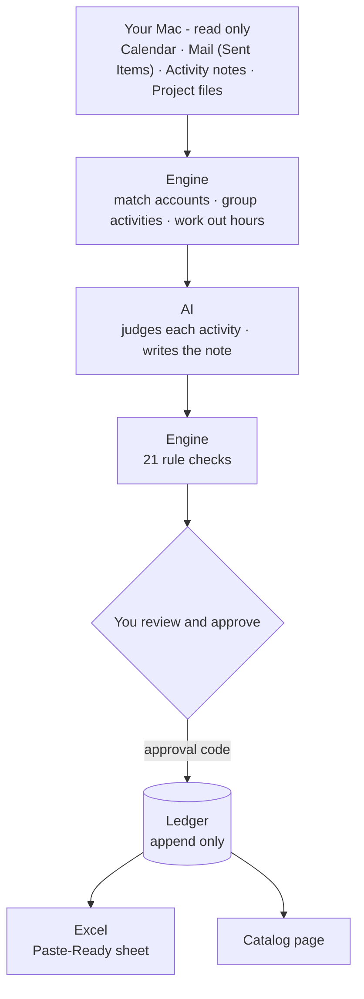
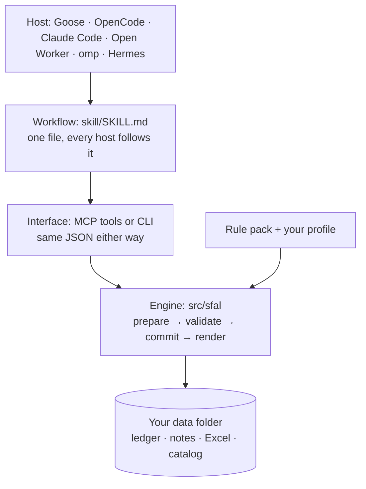

<h1>SF Activity Log</h1>

<strong>Stop rebuilding your week from memory.</strong> 
Capture your work while it is fresh, and turn it into a Salesforce-ready activity log every week
- following the your company's logging guide. You approve everything it logs.

  
  
  
  

  <strong>
    <a href="#get-started-in-three-steps">Quickstart</a> ·
    <a href="docs/understand/how-it-works.md">How it works</a> ·
    <a href="docs/README.md">Docs</a> ·
    <a href="docs/faq.md">FAQ</a> ·
    <a href="docs/troubleshooting.md">Troubleshooting</a> ·
    <a href="SECURITY.md">Safety</a>
  </strong>

## The problem

Most SEs log activity in Salesforce in batches, weeks after the work, rebuilding it from memory,
calendar and email. It takes an hour or two each time, and details and hours get lost.

SF Activity Log fixes this with two habits:

- **Capture a note, daily.** Right after a meeting, say what happened in one sentence. The tool
  pulls that day's meetings, emails and files and writes a detailed activity note.
- **Log your week, weekly.** It gathers the week's evidence, applies the rules, asks only what it
  cannot know, and gives you an Excel file in Salesforce form order. You approve it before it counts.

## How it works

The engine does the exact work: dates, hours, rules, checks and every write. The AI does the
judgment. You have the last word.

| Who | Does | Never does |
|---|---|---|
| **Engine** (Python) | reads sources, matches accounts, works out hours, runs 21 checks, writes the ledger | guess, or write without your approval code |
| **AI** (your tool) | groups evidence into activities, picks the type, writes the notes, asks you questions | write the ledger, invent a number, or edit a record |
| **You** | answer the few questions, review the table, say *approve* | |

## Architecture

One engine, any AI tool: switch tools and nothing is lost, because the ledger and profile stay
the same. The detail is in [Architecture](docs/understand/architecture.md).

## See it in action

A calendar entry *"ACME - incident summarisation demo"* (Tue 6 Oct, 1.5 h) and a *"Demo agenda"*
email to the same customer become one record. You are asked about prep time and answer `30m`:

| Account | Type | Date | Hours | Prep | Notes |
|---|---|---|---|---|---|
| ACME Bank | 07 · Product Demo | 2026-10-06 | 1.5 | 0.5 | Demonstrated incident summarisation to the ACME ITSM team; agenda sent 5 Oct. |

The engine checks it (hours do not exceed the meeting, the date matches the evidence, the account
is in your list), you say *approve*, and the record lands on the **Paste-Ready** sheet. The
**Evidence Trail** sheet links it back to the meeting and the email. Full walk-through:
[How it works](docs/understand/how-it-works.md).

## What you get

| | |
|---|---|
| **Activity notes** | a detailed note per activity: account, what was done, outcomes, people, next steps, hours |
| **Weekly Excel** | 6 sheets; the Paste-Ready sheet follows the Salesforce form order |
| **Catalog page** | every note, record and week in one place, with search, a calendar and "not logged yet" flags |
| **Rules as code** | a rule pack (22 activity types, account routing, delivery vs prep hours) and 21 checks; use your own pack with `rules_pack` |
| **Honest gaps** | it asks about what the evidence cannot settle; anything unproven stays `[to confirm]` |
| **History** | an append-only ledger; fix or remove a record later and every version is kept |

## Works with your AI tool

| Tool | Model | Where your data goes |
|---|---|---|
| Goose Desktop · Goose CLI · OpenCode · omp · Hermes · Open Worker | Cortex (company AI) | the company AI only |
| Claude Code | Claude | Anthropic - check your company's policy first |

The AI sees meeting titles, attendee names and domains, email subjects and short previews, note
summaries and file names. It never sees file contents or your whole mailbox. More:
[Safety](docs/understand/safety.md) · [AI tools](docs/understand/ai-tools.md).

## Get started in three steps

1. **Add your work Outlook account to macOS Calendar and Mail.** This is required: the tool reads
   your calendar and email through those apps, and the email part cannot work without it.
2. **Follow the page for your AI tool**, from top to bottom (about 30 minutes, once):
   [Goose Desktop](docs/start/goose-desktop.md) (easiest) ·
   [Goose CLI](docs/start/goose-cli.md) ·
   [OpenCode](docs/start/opencode.md) ·
   [Claude Code](docs/start/claude-code.md) ·
   [Open Worker](docs/start/openworker.md) ·
   [omp](docs/start/omp.md) ·
   [Hermes](docs/start/hermes.md)
3. **Use it.** Needs macOS 14+ and Python 3.11+.

| When | Job | Goose (Desktop recipe) | OpenCode |
|---|---|---|---|
| Once | Set up your profile | SF Activity Log - Setup | `/sf-log-setup` |
| Daily | Capture a note | Log Activity Note | `/log-activity-note` |
| Weekly | Log your week → Excel for Salesforce | SF Activity Log | `/sf-log last week` |

## Safety

- **Nothing is logged without your approval.** The approval code ties the commit to exactly what you reviewed.
- **Nothing is invented.** Every record cites its evidence; unknowns are marked, not filled in.
- **History is never lost.** The ledger only grows, and every action is in an audit log.
- **Read-only on your sources.** It writes only to its own data folder, plus activity notes you ask for.
  Details: [SECURITY.md](SECURITY.md) · [Safety guarantees](docs/understand/safety.md).

## Documentation

| I want to | Go to |
|---|---|
| Install and run it the first time | [Start](docs/README.md#start-here) |
| Do a task, or look up a command, setting or rule | [Use it](docs/README.md#use-it) · [Look it up](docs/README.md#look-it-up) |
| Understand how it works | [Understand it](docs/README.md#understand-it) · [How it works](docs/understand/how-it-works.md) |
| Fix a problem, ask a question, or see what changed | [Troubleshooting](docs/troubleshooting.md) · [FAQ](docs/faq.md) · [Changelog](docs/maintainers/changelog.md) |

**Contributing:** see [CONTRIBUTING.md](CONTRIBUTING.md). AI coding agents: read [AGENTS.md](AGENTS.md) first. **Licence:** [MIT](LICENSE).
