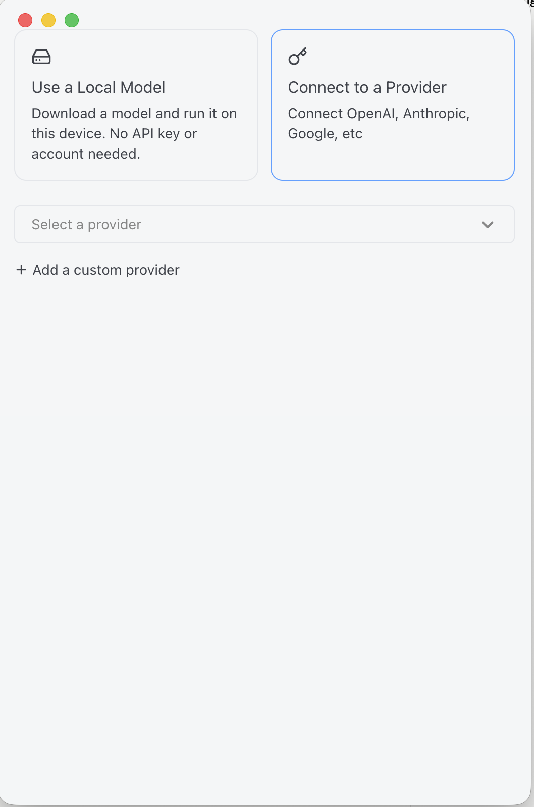
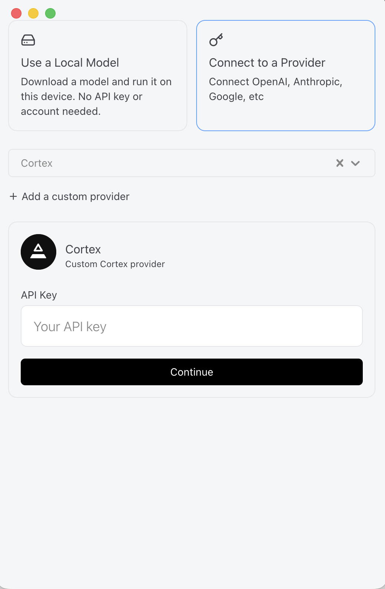
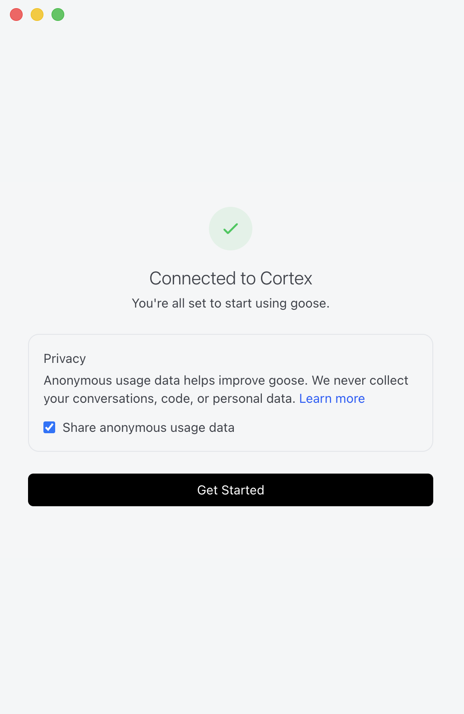

# Get started with Goose Desktop

> From nothing to your first note and your first weekly log, in the Goose app.
> About 30 minutes, once. Follow the steps in order.

**Before you start:** a Mac (macOS 14+), **your work Outlook account added to macOS Calendar and
Mail**, a Cortex API key, and access to the code repository (ask the owner to add your GitHub account).

> **Required, not optional:** the workflow reads your calendar and email through the macOS
> Calendar and Mail apps. Without your work Outlook account added there, the email part cannot work. Step 1 shows how.

## 1. Add your work account to macOS

System Settings → **Internet Accounts** → **Add Account** → **Microsoft Exchange**. Sign in with
your work email and turn on **Calendars** and **Mail**. Your meetings appear in the Calendar app
within a few minutes.

## 2. Install the basics

In Terminal ([Homebrew](https://brew.sh) needed):

```bash
xcode-select --install
```

```bash
brew install python && brew install --cask block-goose
```

## 3. Connect Goose to Cortex

Create the Cortex provider file:

```bash
mkdir -p ~/.config/goose/custom_providers && cat > ~/.config/goose/custom_providers/custom_cortex.json <<'EOF'
{
  "name": "custom_cortex", "engine": "openai", "display_name": "Cortex",
  "api_key_env": "CORTEX_API_KEY",
  "base_url": "https://cortex.mycompany.example/v1/chat/completions",
  "models": [{ "name": "cortex-fast", "context_limit": 262144 }],
  "supports_streaming": true, "requires_auth": true
}
EOF
```

Open **Goose** → **Connect to a Provider** → choose **Cortex** (not *Add a custom provider*).



Paste your Cortex API key → **Continue** → **Get Started**.



**You'll see:** *Connected to Cortex*, and `cortex-fast` in the model selector.



## 4. Install SF Activity Log

```bash
git clone https://github.com/amrsingh29/sf-activity-log-public.git ~/Developer/sf-activity-log
```

You can clone it anywhere; the examples use `~/Developer/sf-activity-log`. After installing,
the tools always find it through `~/.sf-activity-log/bin/sfal`.

```bash
bash ~/Developer/sf-activity-log/hosts/goose/install.sh
```

Quit and reopen Goose. **You'll see** under **Recipes**: *Log Activity Note*, *SF Activity Log*
and *SF Activity Log - Setup*. Use ▶ **Run** on a recipe; don't use ✎ Edit or 🕒 Schedule.

## 5. Set up your profile

Recipes → **SF Activity Log - Setup** → ▶. It scans your customer folder, calendar and sent
mail, then asks one topic at a time: your name as in Salesforce, company email domains, folders,
where to keep your log, sources, personal blocks to ignore, customers and partners. It saves only
when you say yes.

When macOS asks about **Goose**, allow **Full Access** to Calendars and **OK** to control Mail.

## 6. Capture your first note

Recipes → **Log Activity Note** → ▶. Describe something you did today, e.g.
*"ACME demo went well, pricing due Friday"* - or leave it empty and pick from today's items.
Check the note it shows and say **y**. [More](../use/capture-a-note.md)

## 7. Log your first week

Recipes → **SF Activity Log** → ▶, period `last week`. Read the source summary, answer the
questions (Enter keeps the default), check the review table, type **approve**.

**You'll see:** an Excel file in Downloads. Open **Paste-Ready** and paste into Salesforce.
[More](../use/log-your-week.md)

If Goose asks for a keychain password that does not work: [Troubleshooting](../troubleshooting.md#goose).

Next: [Capture a note](../use/capture-a-note.md) · [Log your week](../use/log-your-week.md)
