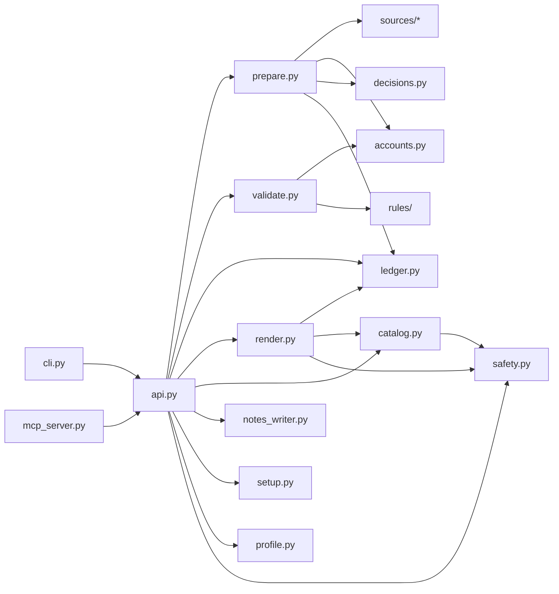
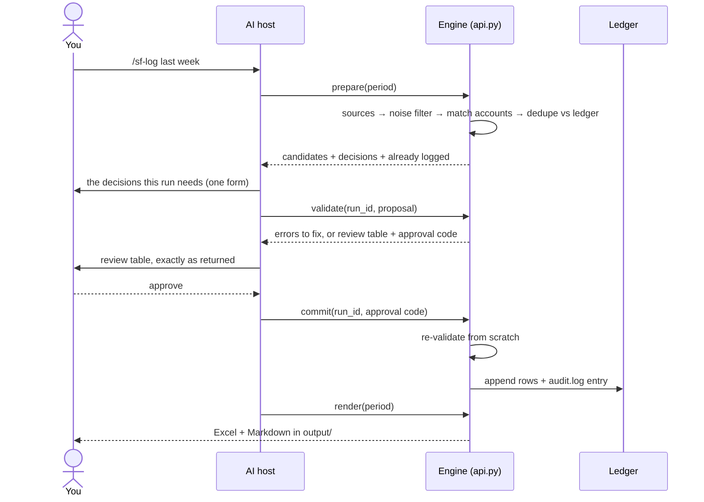

# Architecture

> How the pieces fit: one engine, several AI hosts, a versioned rule pack and a single append-only ledger.

## The shape

```text
┌───────────────────────── host (you + the AI) ──────────────────────────┐
│  Goose · OpenCode · Claude Code · Open Worker · omp · Hermes           │
│  /sf-log   /log-activity-note   /sf-log-setup   + host question tool   │
└───────────────────────────────┬────────────────────────────────────────┘
                                │  skill/SKILL.md - the workflow every host follows
                 ┌──────────────┴───────────────┐
                 │  sfal_* MCP tools (18)      │  sfal CLI (same JSON)
                 └──────────────┬───────────────┘
                                ▼
┌─────────────────────────── engine: src/sfal ───────────────────────────┐
│  api.py - one function per stage, behind both interfaces               │
│                                                                        │
│  prepare ──► propose ──► validate ──► commit ──► render                │
│  engine      AI          engine       engine      engine               │
│                                                                        │
│  reads:  rules/example-rules-1.0.yaml · profile.yaml · the ledger    │
│  writes: ledger/ (only) · output/ · cache/<run_id>/ · catalog/         │
└────────────────────────────────────────────────────────────────────────┘
```

The engine is ordinary Python and runs from a terminal on its own. An AI host only calls these
operations (or, without MCP, writes `proposal.json` and calls `sfal validate`); it never writes
the ledger, never edits a record and never moves anything in the data folder by hand.

## Layers

| Layer | Lives in | Job |
|---|---|---|
| Host | Goose, OpenCode, Claude Code, Open Worker, omp, Hermes | Runs the workflow, asks you the questions, shows the review |
| Workflow | `skill/SKILL.md`, `skill/NOTE.md`, `hosts/<tool>/` | The instructions the AI follows, one file for every host |
| Interface | `cli.py`, `mcp_server.py` | Thin adapters over `api.py`; both print the same JSON |
| Stages | `api.py` | `prepare`, `validate`, `commit`, `render` + setup and notes |
| Domain | `prepare.py`, `validate.py`, `ledger.py`, `render.py`, `catalog.py` | All exact work: filtering, rules, hours, files |
| Config | `rules/example-rules-1.0.yaml`, `profile.yaml` | Shared org rules · one personal profile per person |
| Data | `data_dir`, `mirror_to` | Ledger, run cache, output, notes, catalog |

## Module map



`safety.py` guards every writer that can reach outside the engine's own folders: `api.py`
(the saved proposal), `render.py` (output + mirror) and `catalog.py`. `prepare.py` writes only
inside its own run cache, and `notes_writer.py` writes to the notes folder by design (see below).
`period.py`, `textdates.py` and `evidence.py` are shared helpers with no dependencies of their own.

## A weekly run, end to end



Only `propose` (grouping evidence, choosing the type, writing Notes) is the AI's. Every arrow
labelled *engine* is deterministic and gives the same answer on any model.

## What a run leaves on disk

| Path | Holds | Written by |
|---|---|---|
| `cache/<run_id>/raw/` | Per-source raw dumps | each `sources/*.collect` |
| `cache/<run_id>/evidence.json` | Every item, filtered or not, with its flags | `prepare.py` |
| `cache/<run_id>/candidates.json` | Live items, decisions, already-logged, open records | `prepare.py` |
| `cache/<run_id>/proposal.json` | The AI's proposed changes | the AI, via validate |
| `cache/<run_id>/validation.json` | Errors, warnings, held rows, approval code | `validate.py` |
| `cache/<run_id>/commit.json` | The approval code and entry ids written | `commit` |
| `ledger/ledger.csv` | 25-column append-only record | `ledger.py` only |
| `ledger/audit.log` | One JSON line per write | `ledger.py` only |
| `output/<year>/<kind>/<label>/` | `xlsx`, `md`, `runs.md`, `history/`, `.snapshot.json` | `render.py` |
| `notes/` | Activity notes, never overwritten | `notes_writer.py` |
| `catalog/index-modern.html` | Every note, record and period in one page | `catalog.py` |

The folder type (`days`, `weeks`, `months`, `ranges`) comes from the period's dates, so the same
period always lands in the same place and a re-render keeps the previous version in `history/`.

## Where the safety lives

- **Write boundary** - `safety.check_writable` refuses any path outside `data_dir` and
  `mirror_to`. It guards the proposal save, the render and the catalog. Two writers sit outside
  it on purpose: `prepare.py`, which only ever writes its own cache folder, and
  `notes_writer.py`, which writes into `data_dir/notes/` or - when the profile allows it - a
  folder matched to the account, checked against an allow-list of that account's folders.
- **Approval** - `commit` re-runs the whole validator and compares the approval code (an 8-char
  sha256 of the changes the user saw). A proposal edited after review cannot commit.
- **Single writer** - only `ledger.py` writes the ledger, behind an `flock`, via a temp file and
  an atomic replace. Corrections void and supersede; rows are never deleted.
- **No fabrication** - checks C12/C13 tie hours and dates to cited evidence, C04 caps hours at
  the evidence, and `[to confirm]` is the only placeholder. Held rows are kept but stay out of
  Paste-Ready.

## Adding to it

| To add | Change |
|---|---|
| A source | New `sources/x.py` with `collect(profile, rules, d0, d1, raw_dir) -> (items, report)`, register it in `prepare.ENGINE_SOURCES`, add it to `profile_template.yaml` and `api.SOURCES` |
| A rule check | Add to `validate.CHECKS` and implement in `Validator._check`, then `make docs` |
| A host | Nothing in the engine: MCP + `skill/SKILL.md` are already host-neutral. Add `hosts/<name>/install.sh` |
| A rule pack version | New `rules/*.yaml`; every ledger row keeps the version it was validated under |

## Design vs as built

[Design](../maintainers/design.md) is the pre-build plan: goals, decisions log and phases.
Three things arrived after it was written and are not in it: `notes_writer.py` (the daily note
command), `catalog.py` (the searchable index) and `decisions.py` (the engine, not the AI,
deciding which items need your call). GBrain stayed a host-side MCP lookup - it is never a
source of dates or hours.

More: [How it works](how-it-works.md) · [AI and engine](ai-and-engine.md) · [Safety](safety.md)
